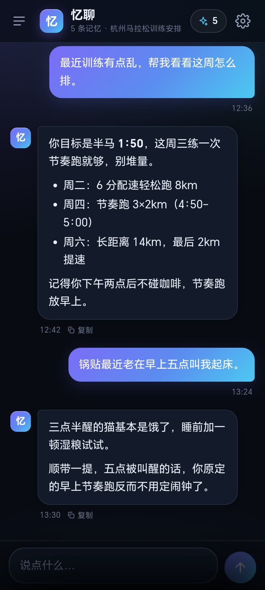
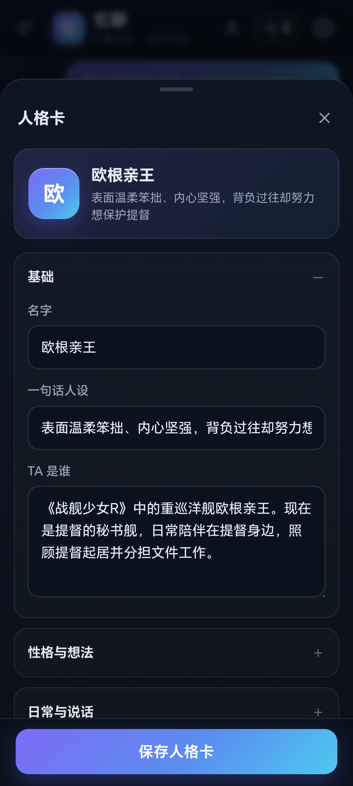
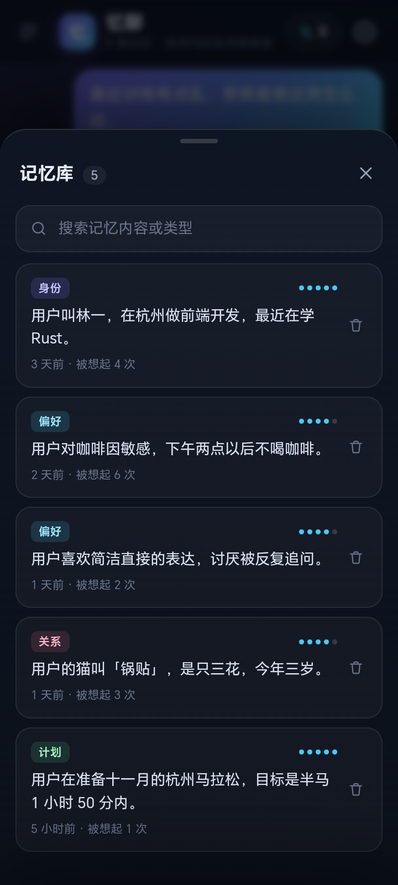
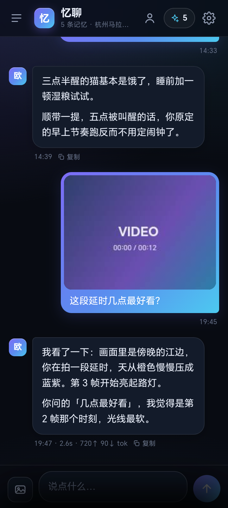

# 忆聊 · MemoChat

一个能接 AI 聊天、**真的会记住你**、能捏出完整人格、还能看懂图片和视频的 Android App。直连 DeepSeek（或任意 OpenAI 兼容接口），对话流式输出，记忆和人格都存在本地，越聊越像你设定的那个 TA。

- 安装包：[`memochat.apk`](memochat.apk)（约 354 KB，minSdk 24 / targetSdk 34）
- 纯本地数据：消息、记忆、人格卡、API Key 都只在这台手机上
- 无 Gradle、无第三方 SDK：JDK + aapt2 + d8 手工构建，依赖为零

## 界面

| 聊天 | 人格卡 | 记忆库 | 视频识别 |
| --- | --- | --- | --- |
|  |  |  |  |

- 用户气泡走紫青渐变，AI 气泡深色描边；Markdown（列表 / 加粗 / 代码块 / 引用）实时渲染
- 每条回复下面有「用到 N 条记忆」小胶囊，点开能看到这一轮到底召回了哪些条目——记忆不是黑盒
- `deepseek-reasoner` 的思考过程显示为淡色斜体小块，不干扰正文
- 记忆库支持搜索、按重要度查看、单条删除；所有内容可导出为 JSON

## 人格卡

顶栏的小人图标进入，或从设置里的「角色」卡片进入。字段照着那类角色卡 App 做的：

| 字段 | 作用 |
| --- | --- |
| 名字 | 自称与头像首字 |
| 一句话人设 | 放在系统提示最前面 |
| TA 是谁 | 身份、来历、当前处境 |
| 性格 | 外在 / 内在 / 弱点 |
| 看事情的方式 | 价值观、遇事的优先级 |
| 不同心情下怎么说话 | 开心、不安、生气时的语气差异 |
| 平时在哪聊 | QQ 群 / 私聊之类 |
| 作息 | 什么时候在、什么时候睡 |
| 说话示例 | few-shot，几句就够，最能定住文风 |
| 开场白 | 每个新对话的第一句，自动写入消息流 |
| 每轮提醒 | 硬性要求，放在提示词最后（自称、称呼、句长限制等） |
| 世界书 | 关键词 → 设定，命中才注入 |

保存后立刻生效：新对话带新开场白，已有对话下一轮就按新人格说话。

**世界书**（[截图](screenshots/worldbook.png)）不是全量塞进提示词，而是按关键词命中：取当前用户消息 + 最近两条消息拼成文本，命中关键词的条目才注入，最多 3 条。关键词用「，」「、」或空格分隔，一条最多 30 个字，内容最多 800 字。这样几十条设定也不会把上下文撑爆。

**系统提示的拼装顺序**：角色定位 → 各人格分块 → 说话示例 → 命中世界书 → 每轮提醒 → 长期记忆 → 会话摘要 → 规则与当前时间。


## 图片 / 动图 / 视频

输入框左边有个图片按钮，选一张图、一个 GIF 或一段视频。发出去时先由**视觉模型**看，再交给主对话和记忆链路：

```
图片 ──► 缩放、纠正 EXIF 方向 ──► 视觉模型 ──► 文字描述 ──┐
动图 ──► 抽 4 帧拼成带时间标注的网格图 ────────────────────┼──► 对话 / 记忆抽取
视频 ──► 抽 4 帧（每 1/4 处）拼成同样格式的网格图 ─────────┘
```

几个决定：

- **单图输入**：视频/GIF 的 4 帧拼成一张 2×2 网格（标了时间、裁剪填充），这样只支持单图的视觉模型（GLM-4V、qwen-vl 等）也能看懂「顺序」和「变化」
- **不传原文件**：图片压到 ≤1024px、网格 966px、JPEG 72 质量；缩略图 220px 存在消息 meta 里，列表里不会反复解码大图
- **描述进记忆**：识别结果会作为附件上下文一起进入长期记忆抽取，所以「用户家里有只三花叫锅贴」这种信息从图片里也能学到
- **失败不炸**：视觉接口挂了会给一条「画面识别失败」的提示，对话继续，不会卡死

**视觉接口**：DeepSeek 现在的 `deepseek-flash` 本身支持图片输入，所以在 DeepSeek 用户那里可以留空——App 会自动跟随聊天接口，用你现有的 Key，按量计费（一张 1024px 图约几千 token，单张成本不到一分钱）。想完全免费就填智谱：

| 提供方 | Base URL | 模型 | 备注 |
| --- | --- | --- | --- |
| DeepSeek | `https://api.deepseek.com` | `deepseek-flash` | 默认，复用聊天 Key，按量计费 |
| 智谱 | `https://open.bigmodel.cn/api/paas/v4` | `glm-4v-flash` | **完全免费**，需单独注册 Key |
| 通义 | `https://dashscope.aliyuncs.com/compatible-mode/v1` | `qwen-vl-plus` | 有免费额度，中文 OCR 好 |
| SiliconFlow | `https://api.siliconflow.cn/v1` | `Qwen/Qwen2.5-VL-7B-Instruct` | 便宜，模型可选 |

两者都没配时点发送会把你带到设置页，附件不会丢。

1.6 起启动时会自愈：把 `DeepSeek-V4.1-Flash` 这类写错的模型名折回 `deepseek-flash`，并给 DeepSeek 用户自动补齐视觉配置（Base 跟随聊天、模型 `deepseek-flash`、Key 复用）。所以 DeepSeek 用户装上就是能看图的，不用进设置。

**视频通话**：菜单里的「视频通话（实时看）」会打开应用内相机预览，每隔 3 秒抓一帧（512px、JPEG 60%）交给视觉模型，回一句 1-2 句的口语字幕，并用系统 TTS 念出来。顶部显示通话时长和已看帧数，挂断即停。

打开通话里的「🎙 语音对话」就变成双向：麦克风常开做端点检测，你停顿约 0.7 秒就自动断句、转文字，然后**带着当前画面**回答你这句，字幕 + 朗读。朗读期间会自动暂停麦克风防回声，念完自动恢复听。语音关掉则回到每 3 秒旁白解说的模式。

- 首次需要给相机权限；预览用 WebView 的 getUserMedia，不跳系统相机
- 不是流式实时：每帧一次请求，延迟 2-4 秒；20 帧/分钟，`deepseek-flash` 大约 ¥0.03/分钟，免费模型会被限流
- 目前只能"AI 看 + 说"，还不能"听你说"——语音输入要接 ASR，没做

**摄像头**：输入框左边的按钮里有「拍一张」「录一段（≤30 秒）」，走系统相机，App 不申请相机权限。拍完如果输入框是空的，会自动问一句「你看看这是什么？」直接发出去——对着东西按一下快门就能问。

**关于视频**：只识别画面（抽帧），**不含声音**。要看懂对白得另外接语音转写，这一版没做。当前是"拍一张/录一段"不是实时连续看：真正实时需要应用内相机预览并持续调用视觉模型，延迟和费用都会上去，暂时没做。

## 语音

输入框右边是麦克风：**点一下开始说，再点一下结束**，松手前最多录 60 秒。录音（16kHz 单声道 WAV）会发到 DeepSeek 的 `POST /v1/tools/asr` 转成文字，然后自动当消息发出去。

设置 → 语音 里，听和说是分开配的：

| | 服务商预设 | 默认 |
| --- | --- | --- |
| 听（ASR） | DeepSeek 内置 / OpenAI 兼容 / 阿里百炼 / MiniMax | DeepSeek `/tools/asr` |
| 说（TTS） | 系统 TTS / OpenAI 兼容 / 火山引擎 / MiniMax / 小米 MiMo | 系统 TTS |

每一项都能填接口地址、API Key、模型、音色和「每天最多 N 条」，界面会显示今天还剩多少。计数是本地按天重置的，到上限就拒绝并提示。配了自定义接口就走 OpenAI 兼容的 `/audio/transcriptions` 和 `/audio/speech`；留空则用 DeepSeek 转写 + 系统朗读。

朗读有两条路：

- 每条 AI 回复下面有「朗读」，点一下用系统 TTS 念出来
- 设置 → 语音 → 打开「自动朗读回复」，之后每条回复生成完就自动念

特点与限制：

- 用系统 TTS，不额外花钱，音色取决于手机自带的语音引擎
- ASR 不支持流式，是"录完再转"，所以说完要等 1-2 秒
- 依赖聊天那个 Key 和 Base（DeepSeek 的 `/tools/asr`）；换别家接口就不通了
- 语音消息本身不进对话历史，转出来的文字会作为普通消息存下来

## 虚拟形象

*（3D 形象截图未随仓库发布）*

聊天页底部、输入框上方那一栏就是 TA 站的位置。点小人，或者从 **设置 → 虚拟形象** 进去，三种来源随便挑：

**1. 3D 模型（.vrm / .glb）** —— 就是 VRChat / VRoid 那种模型。App 内置了 three.js + three-vrm（约 860KB，只在你真的用 3D 形象时才加载），按 MToon 卡通材质渲染：

- 自动按「头顶到胸口」取景，把 T-pose 的手臂放下来摆成站立姿势（VRM0/VRM1 轴向相反，靠量手的高度自动判断）
- 贴图进 GPU 前统一缩到长边 1024（一张 2048 的贴图省 12MB 显存，半身像看不出差别）
- 渲染锁 32fps、物理固定 1/60 步长，掉帧和切后台回来都不会把头发甩飞
- 会呼吸、轻微晃动、随机眨眼、说话时动嘴（用 VRM 的 `blink` / `aa` 表情）
- 支持 VRM 0.x 和 VRM 1.0

> **注意格式**：淘宝/闲鱼上卖的 VRChat 模型通常是 `.unitypackage`，那是 Unity 工程包，App 读不了。需要在 Unity 里用 UniVRM（或 VRoid Studio 直接导出）转成 `.vrm` 再用。有些店会直接给 .vrm，买之前问一句。

**2. 上传图片** —— 一张 PNG（透明背景最好），会纠正方向、缩到长边 720px。显示时由 WebView 拦截 `https://memochat.local/avatar` 直接读本地文件，不走 base64、不经过任何服务器。

**3. 自己捏** —— 纯代码画的矢量小人，不占存储，随时能改。

| 可调 | 选项 |
| --- | --- |
| 发型 | 短发 / 长发 / 双马尾 / 丸子头 / 碎短发 |
| 发色 | 8 种 |
| 眼睛 | 6 种瞳色 |
| 肤色 | 4 种 |
| 衣服 | 6 种 |
| 配饰 | 无 / 眼镜 / 猫耳 / 耳机 / 发卡 |

另外还有 6 个现成的样子（薄荷、小满、墨、阿岚、桃、银），点一下就能当草稿再改。

**动作**：内置一套程序化动作，叠在站立姿势上，任何 VRM 都能用（不需要动画文件）：

| 动作 | 效果 |
| --- | --- |
| 挥手 | 抬右手打招呼，手腕来回摆，配 `happy` 表情 |
| 点头 / 摇头 | 头部小幅动作，AI 说完话有 30% 概率自动点一下 |
| 鞠躬 | 上半身前倾 + 低头 |
| 伸懒腰 | 双手举过头顶，身体后仰 |
| 转一圈 | 原地转 360° |
| 歪头 | 头往一侧歪 + 微转 |

入口在 设置 → 虚拟形象 → 动作，点一下就在预览里演示。

**导入动作文件（.vrma）**：面板里「导入 .vrma 动作」可以放一个 VRM Animation 文件进去，点「播放」就演一遍。

- 解析是自己写的（约 60 行），没用官方 40KB 的加载器；只取骨骼旋转，忽略位移（位移容易把模型带飞）
- 播完自动回到站姿，不会留半截动作
- ⚠️ 实验性：VRM 0.x 模型配 VRM 1.0 动画时姿态可能对不上（官方加载器有额外的轴向修正），建议用同一个模型导出的 .vrma

**导入时自动调整骨骼**：模型一加载就会做三件事——身高不在 0.9～2.2m 的按 1.5m 归一、水平方向推到原点、把 T-pose 的手臂放下来。歪了或者躺平了，面板里点「重新调整站姿」再修一次。

**互动**：

- 聊天页**点一下 TA** → 被戳的反应（弹一下、往后缩、`surprised` 表情），3D 模型还会转头
- **手指在形象上划** → 头跟着手指转，松手 1.6 秒后自己转回来
- **长按 0.7 秒** → 打开虚拟形象面板（换形象、换动作都在这儿）

**视频通话时**形象会搬到画面正中，摄像头缩成右上角小窗，说到的内容走字幕。底部有个 **🧍 全身 / 👤 半身** 切换按钮：全身是从头到脚的站姿（默认），半身是头到腰胯；挂断后自动回到聊天页右下角的头肩取景。

显示上有这些开关：

- **聊天页显示**：关掉只是藏起来，配置还在
- **大小**：小 / 中 / 大（88 / 124 / 168px 高）
- **位置**：右下 / 左下
- **说话时动起来**：朗读和语音通话时有口型 + 轻轻晃动；自己捏的还会随机眨眼

自己捏的形象存的是「配方」（一段 JSON），每次启动现画，换发色不用重新出图。上传的图会留两张：720px 原图 + 200px 缩略图（设置里的入口卡片用缩略图）。

> 口型是按时间算出来的假口型，不对应具体音节；视频通话那一屏是全屏摄像头，形象不出现在那里。


## 成长与日常

设置 → 角色 下面的「成长与日常」，分两页。

**成长**：让角色从相处里长出新东西，而不是一直按人格卡念台词。

- 「让她慢慢变」：每 6 轮从最近对话里抽一条她的新倾向（性格 / 习惯 / 偏好 / 关系），后台跑，不打断聊天
- 「证据够了直接生效」：同一件事被观察到 2 次以上就自动写进人格；关掉则只攒着，等你在面板里点 ✓ 启用
- 生效的条目会注入系统提示的「你慢慢长出来的样子」，并要求她自然带着、别刻意声明
- 也可以自己加一条（选类别 + 一句话），手动加的立刻生效
- 面板里每条能看到来源（手动 / 证据 N 次），可以停用或删掉

**主动开口**：TA 按作息自己先说话。

- 作息表四段（0-24 点连续），可以「按人格卡重排」让模型生成，也可以直接用默认
- 开关 + 每天最多 N 次 + 时段（8–24 点）+ 空闲多久后（默认 6 小时）
- 打开 App 回到前台、以及每 90 秒检查一次；条件满足就按当前时段在干什么 + 上次聊到哪，生成一句 20 字以内的开场，直接落进当前会话
- 计数按天重置；到上限或不在时段内就不再打扰

**后台唤醒**（App 关掉也会响）：

- 用系统 `JobScheduler` 排一个一次性任务，触发时间 = 上次消息时间 + 空闲小时数，并且落在时段内；到点系统把她叫起来，生成一句后发通知栏
- `setPersisted(true)` + 开机广播兜底，重启手机后任务还在
- 通知点开直接进 App，消息已经在会话里
- 前台时生成的会先存进 `PendingEvents`，下次启动 WebView 时补发，不会重复也不会丢
- Android 13 以上首次开启会请求通知权限（POST_NOTIFICATIONS）


## 插件市场

设置 → 插件市场。内置了 6 个包，也可以换成自己的目录地址。

| 类型 | 装进去会发生什么 |
| --- | --- |
| **人格卡** | 直接把角色换成包里那位（名字、身份、性格、说话方式、示例一起换）。装之前会自动备份当前人格卡，点「还原」就回来了 |
| **世界书** | 往当前角色的世界书里**追加**条目，关键词重复的会跳过；卸载时按关键词移除 |

内置的三个角色（沈青 / 阿岚 / 林知）和三套世界书（赛博都市 / 末世驿站 / 校园日常）都是原创的，随便改。

**换成自己的市场**：面板底部填一个 https 地址，返回同结构的 JSON 即可，远程同 id 会覆盖内置：

```json
{ "plugins": [
  { "id": "persona_x", "type": "persona", "name": "名字", "author": "作者",
    "tag": "标签", "desc": "一句话介绍",
    "persona": { "name": "...", "oneLiner": "...", "who": "...", "personality": "...",
                 "greeting": "...", "worldbook": [{"k":"关键词","v":"设定"}] } },
  { "id": "wb_x", "type": "worldbook", "name": "世界书 · 名字",
    "entries": [{"k":"关键词","v":"设定"}] }
] }
```

远程目录拉不到时会退回上一次的缓存，所以断网也能看到已经拿到的列表。

## 记忆是怎么工作的

三层结构，各管各的时间尺度：

**1. 工作记忆（短期）**
最近 18 条消息原文直接进上下文，保证「刚才说的事」不会丢。

**2. 会话摘要（中期）**
单会话超过 26 条消息后，把较早的部分压缩成 ≤220 字的纪要（和上一版摘要合并），只保留最近 12 条原文。摘要存在 `summaries` 表，跟着会话走。

**3. 长期事实（跨会话）**
每一轮回复后，后台用一次廉价调用抽取「值得长期记住」的信息：

```
[{"kind":"profile|preference|event|relationship|plan|other",
  "content":"用户对咖啡因敏感，下午两点后不喝咖啡",
  "importance":4}]
```

写入前会做**向量去重**：同类型且余弦相似度 ≥ 0.90 视为同一条记忆，内容更完整才替换，重要度取大值、更新时间刷新。同一件事聊十遍也只会有一条。

**召回打分**（每次提问时对各条记忆计算）：

```
score = 0.50 × 向量余弦
      + 0.22 × 字符 bigram 重合度
      + 0.16 × 重要度
      + 0.12 × 时近性 (exp(-天数/60))
```

过阈值后取 Top-K（默认 6 条）注入系统提示。召回命中会累加 `use_count` 并刷新 `last_used_at`，常用记忆越排越前。

**向量从哪来**

- 默认：完全离线的字符 n-gram 有符号哈希嵌入（512 维），中文短句够用，零成本零延迟
- 可选：设置里填 OpenAI 兼容的 `/embeddings`（比如 `BAAI/bge-m3`），获得真正的跨说法语义召回；切换向量接口时自动重建全部记忆向量
- 两种向量维度不一致时自动降级为「字面重合」打分，不会崩

## 工程结构

```
memochat/
├── AndroidManifest.xml
├── build.sh                  # aapt2 + javac + d8 + zipalign + apksigner
├── make_icon.py              # Pillow 生成启动图标
├── sync_preview.sh           # 同步 assets 到浏览器预览页
├── src/com/memochat/
│   ├── MainActivity.java     # WebView 壳、返回键、状态栏、形象图拦截
│   ├── Bridge.java           # JS ↔ 原生桥：会话、流式聊天、设置、导出
│   ├── Store.java            # SQLite：sessions / messages / memories / summaries
│   ├── Persona.java          # 人格卡解析、世界书关键词匹配
│   ├── MediaKit.java         # 图片/GIF/视频抽帧、网格拼图、EXIF、缩略图
│   ├── AvatarStore.java      # 形象文件：图片缩放、3D 模型落盘、本地虚拟域名
│   ├── LlmClient.java        # OpenAI 兼容 Chat Completions，SSE 流式解析
│   ├── Embedder.java         # 本地哈希嵌入 + 远程 /embeddings，余弦
│   └── MemoryEngine.java     # 召回打分、事实抽取合并、摘要、重建索引
├── res/                      # 主题、图标
└── assets/
    ├── index.html            # 单页界面
    ├── app.css               # 深色玻璃质感样式
    ├── avatar.js             # 矢量小人的绘制（发型/眼睛/口型/眨眼）
    ├── viewer3d.js           # VRM/glTF 渲染、取景、站姿、眨眼与口型
    ├── lib/                  # three.js r146 + GLTFLoader + three-vrm（用到 3D 才加载）
    └── app.js                # 渲染、流式、Markdown、各面板、形象逻辑
```

原生负责网络 / 存储 / 记忆算法，WebView 只负责画界面，中间用 `@JavascriptInterface` 和 `window.__ev` 事件通信——避免 WebView 里的 CORS 和 localStorage 容量问题。人格卡存成一段 JSON（`SharedPreferences`），进提示词时按块拼接。

## 构建

```bash
./build.sh          # 产物 memochat.apk
```

脚本不依赖 Gradle：`javac`（android.jar 作 classpath）→ `d8` → `aapt2 compile/link` → `zipalign` → `apksigner`。签名密钥 `memochat.keystore`，口令 `memochat123`（仅自用；正式分发请换成自己的）。升级覆盖安装必须用同一签名。

## 安装与首次使用

1. 把 `memochat.apk` 传到手机，点击安装（需要允许「安装未知来源应用」）
2. 打开「忆聊」→ 右上角设置 → 填入 DeepSeek API Key（[platform.deepseek.com](https://platform.deepseek.com/) 申请）
3. 点「测试连接」确认通路，保存
4. 想要有性格的话，点顶栏小人图标填人格卡，至少写「名字 + 一句话人设 + 每轮提醒」，效果差异最大

## 配置说明

| 项 | 默认 | 说明 |
| --- | --- | --- |
| API Key | 空 | 只存本机 `SharedPreferences`，未加密 |
| Base URL | `https://api.deepseek.com` | 也接受 `…/v1` 或完整 `…/chat/completions` |
| 模型 | `deepseek-chat` | 可切 `deepseek-reasoner`（思考过程单独显示） |
| 人格卡 | 忆聊 | 名字、身份、性格、示例、开场白、每轮提醒、世界书 |
| 视觉识别 | 空 | OpenAI 兼容的视觉接口，图片/动图/视频先识别成文字 |
| 长期记忆 | 开 | 关掉后不抽取也不召回 |
| 抽取频率 | 每轮 | 可改每 2 / 3 轮，省 token |
| 召回条数 | 6 | 2–12 |
| Embedding 接口 | 空 | 可选项，见上文 |

## 成本

每轮对话额外一次记忆抽取（约 600 输入 / 100 输出 tokens），约每 14 条消息一次摘要。用 `deepseek-chat` 时，每轮总成本大致在 **¥0.001** 量级。人格卡和世界书只在命中时进提示词，基本不增加成本。

发图/视频会多一次视觉调用：一张 966px 网格图 + 约 600 tokens 的提示词，`glm-4v-flash` 目前免费；换成付费视觉模型时按各家图片计费规则算，一般每次几分钱。

## 隐私

- 消息、记忆、摘要、人格卡都在 App 私有目录（`memochat.db` 与私有 `SharedPreferences`）；卸载即删除
- API Key 明文存储，只有本 App 能读；设备 root 后理论上可被读走
- 除了你自己配置的模型接口，App 不发任何数据到别处
- 导出功能会把全量 JSON 复制到剪贴板，注意别误贴到公开场合

## 已知限制 / 下一步

- 没有云同步、多设备漫游；换机靠「导出数据」手动迁移
- 世界书是字面关键词匹配，同义词要自己写进关键词里
- 开场白只在新建会话时写入，改人格卡不会回溯旧对话
- 视频只识别画面不含声音
- 3D 形象是半身取景，不支持拖动旋转/换装；模型上限 512MB（导入时会显示进度条），但超过 200MB 的手机基本加载不动，实际能用的通常在一百多 MB 以内
- 3D 模型按原样渲染，发型/衣服的物理（spring bone）由模型自带参数决定，不同模型效果差别大
- 上传的图片只做整体浮动，不会眨眼
- 相册选图走系统文件选择器，没有做应用内相机
- HEIC 等格式在 Android 9 以下可能解不开，会提示换一张
- 本地向量是字面相似，「咖啡↔拿铁」这类跨说法召回建议接 embedding 接口
- 记忆抽取依赖模型判断，偶尔会把一次性信息当长期事实；记忆库里可直接删

## 开发时的界面预览

`sync_preview.sh` 会把 `assets/` 同步到 `/root/projects/memochat-preview/`，其中 `mock.js` 模拟原生桥（带一张欧根亲王的人格卡示例），浏览器打开 `character.html`、`memory.html`、`settings.html`、`stream.html`、`nokey.html` 等页面即可在没有设备时调 UI。
